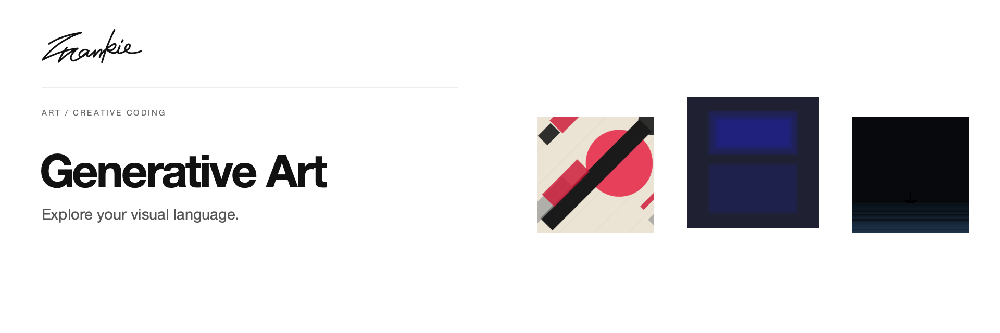

# Frankie Generative Art

[English](README.md) · [简体中文](README.zh-CN.md)

Explore visual styles, choose what resonates, and turn those choices into interactive P5.js artwork.

[Guide](docs/guide.md) · [Run locally](#run-locally)

## What it does

- Browse the style archive and try its live visual previews.
- Choose aesthetic anchors for AI-assisted analysis and synthesis.
- Preview generated work and export a standalone HTML artwork.

## Run locally

```sh
npm ci
npm run dev
```

Open the URL printed by Vite. AI analysis and generation use `GEMINI_API_KEY`, configured in a local `.env.local`.

## Before you start

The archive includes existing interactive examples. AI analysis and new artwork generation depend on Gemini. The detailed guide retains the English and Chinese descriptions and setup notes.

## For developers

```sh
npm run build
```

[Project guide](docs/guide.md) · [Artwork](docs/readme/README.md)

---

Made by [Songhai Fan](https://github.com/SonghaiFan) · A Frankie project
