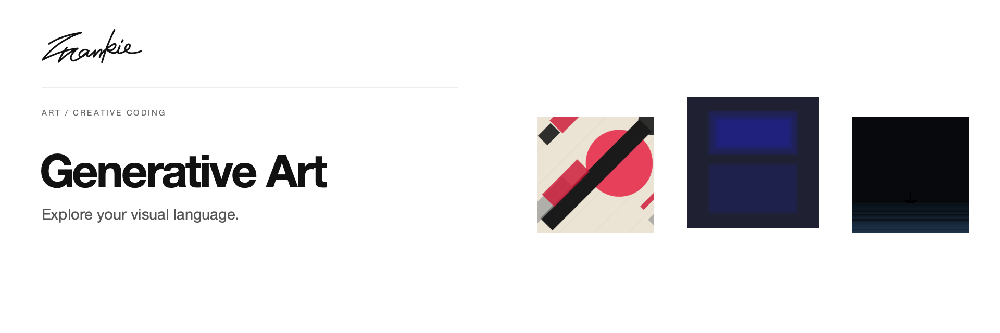

# Frankie Generative Art

[English](README.md) · [简体中文](README.zh-CN.md)

探索视觉风格，选择打动你的作品，再把这些选择转化为可交互的 P5.js 艺术。

[介绍页](https://songhaifan.github.io/frankie-generative-art/zh/) · [项目指南](docs/guide.md) · [本地运行](#本地运行)

## 可以做什么

- 浏览风格档案，体验实时视觉预览。
- 选择审美锚点，进行 AI 辅助分析与融合。
- 预览生成作品，并导出独立 HTML 文件。

## 本地运行

```sh
npm ci
npm run dev
```

打开 Vite 输出的地址。AI 分析与生成使用 `GEMINI_API_KEY`，在本地 `.env.local` 中配置。

## 开始之前

档案中包含现成的交互示例。AI 分析与新作品生成依赖 Gemini，目前需要在本地开发环境配置自己的 key；公开构建不包含该 key。详细指南保留了中英文介绍和配置说明。

## 开发说明

```sh
npm run build
```

[项目指南](docs/guide.md) · [Banner 维护](docs/readme/README.md)

---

由 [Songhai Fan](https://github.com/SonghaiFan) 制作 · Frankie 系列项目
